# RISC-V Bit-Field Processing Unit (BFPU) — Accelerator for Efficient Packed-Data Computing


-brightgreen)


-success)


---

## Project Overview

The **RISC-V Bit-Field Processing Unit (BFPU)** is a lightweight, single-cycle hardware co-processor designed in Verilog RTL to accelerate packed-data manipulation on resource-constrained RV32I processors. Integrated seamlessly with an **unmodified PicoRV32** core via its native **Pico Co-Processor Interface (PCPI)**, the BFPU introduces four custom instructions under the RISC-V `custom-0` (`7'b0001011`) major opcode—`GETFU`, `GETFXU`, `FDSETI`, and `PUTF`—allowing arbitrary-width (1 to 32 bits) bit-field extraction and read-modify-write insertion to execute combinationally in a single clock cycle without stalling the CPU (`pcpi_wait = 1'b0`). By reusing a single shared bidirectional 32-bit barrel shifter and a single shared mask generator across all operations, the BFPU achieves up to **1.99× speedup** (49.7% cycle reduction) and **35.1% energy reduction** across embedded peripheral configuration, networking packet header parsing, and pixel format conversion workloads at a modest FPGA resource overhead of **+9.04% LUTs** and **+6.96% FFs**, passing post-implementation timing at **100 MHz** (`Fmax ≈ 104.2 MHz`) in AMD/Xilinx Vivado.

### Key Highlights

- **Zero-Modification CPU Integration:** Attaches directly to PicoRV32's native PCPI port (`ENABLE_PCPI=1`) with `picorv32.v` kept completely unmodified under its ISC licence.
- **Custom Bit-Field ISA Extension (`custom-0`):** Implements four dedicated instructions (`GETFU`, `GETFXU`, `FDSETI`, `PUTF`) supporting arbitrary bit offsets (`0..31`) and `width-1` encoded field widths (`1..32` bits).
- **Single-Cycle Combinational Datapath:** All four instructions resolve in a single clock cycle with `pcpi_wait` permanently tied low (`1'b0`), incurring zero co-processor stall cycles.
- **Hardware-Sharing Microarchitecture:** Reordered `PUTF` arithmetic (`shift` before `mask`) enables one shared 32-bit bidirectional barrel shifter and one shared mask generator to cover both extraction and insertion with no datapath duplication.
- **4-Entry Descriptor Register File (`FD0`–`FD3`):** Stores `{offset[4:0], width_m1[4:0]}` pairs in a compact 4×10-bit register file, eliminating operand-encoding bottlenecks for 3-operand read-modify-write insertions (`PUTF`).
- **Verified Timing & Compact Footprint (Vivado Post-Implementation):** Consumes only +295 LUTs (+9.04%) and +47 FFs (+6.96%) over the RV32I baseline with 0% additional LUTRAM or I/O, maintaining **PASS @ 100 MHz** (`WNS = +0.402 ns`, `Fmax ≈ 104.2 MHz`).
- **Self-Checking Verification Suite:** Validated via a standalone 100 MHz PCPI testbench (`tb_picorv32_pcpi_bfpu.v`) featuring corner-case directed tests and 200 randomised iterations, alongside system-level simulation waveforms.
- **Multi-Domain Benchmark Gains:**
  - **ADC Register Configuration:** **1.99×** speedup, **49.7%** cycle reduction, **−35.1%** energy.
  - **Packet Header Processing:** **1.53×** speedup, **34.5%** cycle reduction, **−14.4%** energy.
  - **RGB888 → RGB565 Conversion:** **1.34×** speedup, **25.5%** cycle reduction, **−32.0%** energy.
- **Tracked Integration Status:** Standalone unit verification and system-level benchmark simulation are complete; connecting the PCPI signals inside `rtl/top.v` (currently hardwired to zero) is documented as an explicit open item.

---

## Motivation and Problem Statement

Packed binary data structures are fundamental to low-level systems engineering. Firmware drivers routinely pack and unpack multi-bit configuration fields inside memory-mapped I/O (MMIO) control registers (such as ADC resolution, channel selection, and trigger sources). Network stacks parse and mutate unaligned protocol header fields (such as IPv4 DSCP, TTL, and Protocol bytes). Display and graphics pipelines repack pixel channels across bit-depth boundaries (such as converting 24-bit RGB888 to 16-bit RGB565).

In the base **RISC-V RV32I** ISA—which lacks dedicated bit-manipulation extensions—manipulating arbitrary bit-fields requires multi-instruction shift-and-mask sequences:

1. **Bit-Field Extraction Penalty:** Extracting a `width`-bit field at bit `offset` requires shifting the source word to align the field (either shifting right by `offset`, or shifting left then right to clear upper bits) followed by constructing and applying an extraction mask (`ANDI` for small immediates, or `LUI` + `ADDI` + `AND` when masks exceed 12 bits).
2. **Bit-Field Insertion Penalty:** Updating a field in-place (`read-modify-write`) is significantly costlier, typically consuming **3 to 5 RV32I instructions per field operation**:
   - Materialising or loading a precomputed inverted clear-mask (`~pmask`),
   - Clearing the target slice in the destination word (`AND`),
   - Masking and/or shifting the new field value into position (`ANDI`/`SLLI`), and
   - Merging the shifted field back into the cleared destination (`OR`).
3. **System-Level Consequences on Non-Pipelined Cores:** On a compact multi-cycle core such as PicoRV32 (where instruction fetch and execution span multiple cycles per instruction), every extra shift or mask instruction increases instruction memory traffic, expands static binary size, consumes extra temporary registers for precomputed clear-masks, and burns dynamic energy on redundant fetch/decode/ALU cycles.

### Concrete Code Comparison: RV32I Baseline vs. BFPU

Consider configuring a 4-bit trigger field `TRIG[27:24]` (`offset = 24`, `width = 4`) inside an ADC control register, or extracting an 8-bit protocol field. The comparison below contrasts standard RV32I assembly against the BFPU custom instruction flow:

#### Case A: Field Insertion (`TRIG[27:24]` into destination register `x10`, new value in `x11`)

```asm
# ==============================================================================
# Standard RV32I (Clear-mask + Shift + Mask + Merge: 4-5 instructions per op)
# ==============================================================================
# Precomputed inverted mask ~0x0F00_0000 = 0xF0FF_FFFF held in x12 (or loaded via LUI/ADDI)
lui   x12, 0xF1000         # Build upper bits of ~pmask (extra register pressure)
addi  x12, x12, -1         # x12 = 0xF0FF_FFFF (if not pre-loaded in register)
and   x10, x10, x12        # Clear bits [27:24] in destination
andi  x13, x11, 0x0F       # Mask oversized source value to 4 bits
slli  x13, x13, 24         # Shift field left to offset 24
or    x10, x10, x13        # Merge positioned field into destination

# ==============================================================================
# BFPU Accelerated (Conceptual syntax: 1 setup once + 1 instruction per field)
# ==============================================================================
# Once before configuration loop / sequence (sets FD0: offset=24, width-1=3):
#   x5 = (3 << 5) | 24 = 0x0000_0078
FDSETI x0, x5              # FD0 <= {offset=24, width_m1=3} (no GPR write-back)

# Per field update (single cycle, preserves all other bits of x10):
PUTF   x10, x10, x11, FD0  # x10 = (x10 & ~pmask) | ((x11 << 24) & pmask)
```

#### Case B: Field Extraction (`DSCP[23:18]`, `offset = 18`, `width = 6` from packet header `x10` into `x11`)

```asm
# ==============================================================================
# Standard RV32I (Shift-and-Mask: 2-3 instructions)
# ==============================================================================
srli  x11, x10, 18         # Align DSCP[23:18] down to bit 0
andi  x11, x11, 0x3F       # Mask to 6 bits (if width > 11, needs LUI+ADDI+AND)

# ==============================================================================
# BFPU Accelerated (Conceptual syntax: single cycle, arbitrary width 1..32)
# ==============================================================================
GETFU  x11, x10, 18, 5     # x11 = (x10 >> 18) & 0x3F  (offset=18, width-1=5)
```

Across full application kernels—such as configuring 8 sequential sets of ADC registers—these savings eliminate precomputed clear-mask storage and cut static assembly size from **229 lines down to 149 lines**, yielding nearly a **2× speedup**.

---

## Proposed BFPU Architecture

The BFPU is architected as a tightly coupled, single-cycle co-processor peripheral hanging off PicoRV32's native **PCPI (Pico Co-Processor Interface)** bus. Rather than modifying the CPU pipeline or duplicating execution hardware inside the core, all decoding, descriptor storage, barrel shifting, mask generation, and field insertion reside in a modular Verilog subsystem encapsulated by `picorv32_pcpi_bfpu.v`.

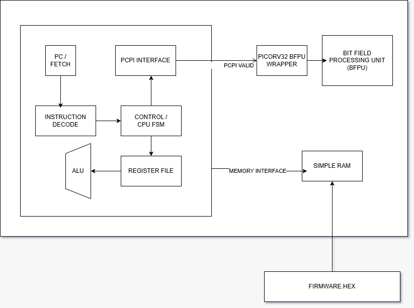

### Architectural Dataflow Overview

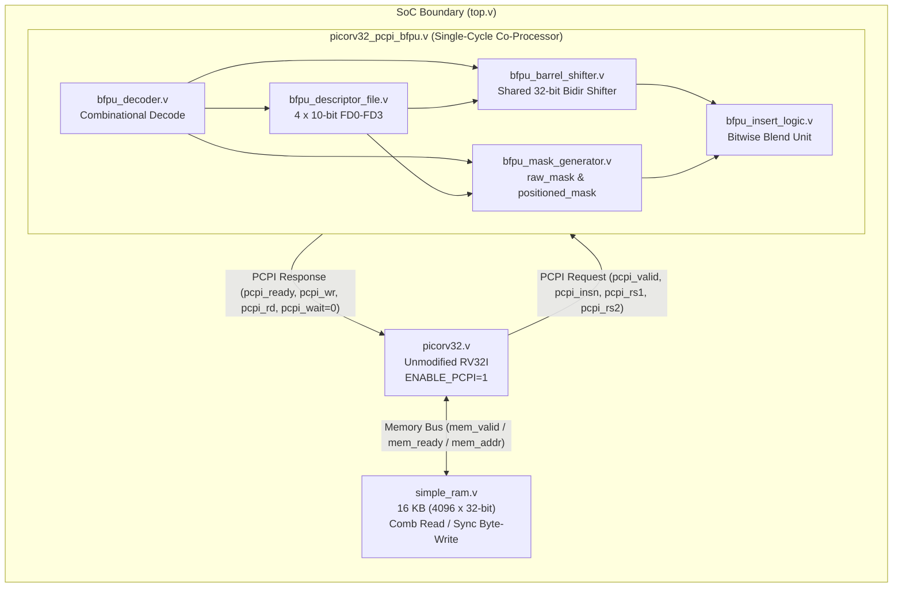

### Design Principles

1. **PCPI Attachment Point:** Whenever PicoRV32 encounters an instruction outside the base RV32I set (specifically major opcode `custom-0 = 7'b0001011`) with `ENABLE_PCPI=1`, it delegates the instruction word (`pcpi_insn`) and source register operands (`pcpi_rs1`, `pcpi_rs2`) across the PCPI port.
2. **Single-Cycle Combinational Resolution:** All four instructions resolve within a single clock cycle. By holding `pcpi_wait` permanently at `1'b0` and driving `pcpi_ready = pcpi_valid && is_bfpu_op`, the co-processor completes execution immediately on the assertion of `pcpi_valid`, allowing PicoRV32 to retire the instruction without multi-cycle co-processor stalls.
3. **Unified Resource Sharing:** Instead of instantiating separate datapaths for extraction (`GETFU`/`GETFXU`) and insertion (`PUTF`), `picorv32_pcpi_bfpu` shares a single 32-bit bidirectional barrel shifter (`bfpu_barrel_shifter.v`) and a single mask generator (`bfpu_mask_generator.v`) through inline multiplexer logic.

---

## Integration with PicoRV32 via PCPI

PicoRV32 provides a standard co-processor port (`PCPI`) specifically intended for extending the RV32I core without editing `picorv32.v`. The BFPU acts as a slave peripheral on this interface.

### PCPI Port Signal Specification

| Signal | Direction (w.r.t. BFPU) | Width | Description |
| :--- | :--- | :--- | :--- |
| `pcpi_valid` | Input | 1 bit | Asserted by PicoRV32 when an unrecognised/custom instruction is presented on the PCPI bus |
| `pcpi_insn` | Input | 32 bits | Full 32-bit instruction encoding fetched by PicoRV32 |
| `pcpi_rs1` | Input | 32 bits | Value read from architectural source register `rs1` |
| `pcpi_rs2` | Input | 32 bits | Value read from architectural source register `rs2` |
| `pcpi_wait` | Output | 1 bit | Stall request back to PicoRV32; **tied to `1'b0`** (single-cycle completion) |
| `pcpi_ready` | Output | 1 bit | Handshake completion pulse: `pcpi_valid && is_bfpu_op` |
| `pcpi_wr` | Output | 1 bit | Register write-back enable: `pcpi_valid && is_bfpu_op && !is_fdseti` |
| `pcpi_rd` | Output | 32 bits | Combinational 32-bit result written to `rd` when `pcpi_wr` is asserted |

*(In addition to the 8 PCPI signals above, standard clock and reset inputs drive synchronous writes and reset-to-zero initialization inside `bfpu_descriptor_file.v`.)*

### Handshake Equations and Control Semantics

The BFPU control handshake is defined by three concise combinational expressions inside `picorv32_pcpi_bfpu.v`:

```verilog
assign pcpi_wait  = 1'b0;
assign pcpi_ready = pcpi_valid && is_bfpu_op;
assign pcpi_wr    = pcpi_valid && is_bfpu_op && !is_fdseti;
```

- **Non-BFPU Instructions (`is_bfpu_op == 0`):** Both `pcpi_ready` and `pcpi_wr` stay low (`1'b0`), ensuring the BFPU ignores instructions belonging to other opcodes or co-processors.
- **Value-Returning Instructions (`GETFU`, `GETFXU`, `PUTF`):** `is_bfpu_op` is high and `is_fdseti` is low. In the same cycle that `pcpi_valid` goes high, both `pcpi_ready` and `pcpi_wr` assert high, `pcpi_wait` stays `0`, and PicoRV32 commits `pcpi_rd` into architectural register `rd`.
- **Descriptor Configuration (`FDSETI`):** `is_bfpu_op` and `is_fdseti` are both high. `pcpi_ready` asserts so PicoRV32 retires the instruction in one cycle, while `pcpi_wr` is forced low (`1'b0`) so `rd` in the CPU general-purpose register file is **not** overwritten; instead, `bfpu_descriptor_file` latches `{rs1[4:0], rs1[9:5]}` into `FD[rd[1:0]]` synchronously on the clock edge.

### Handshake Timing Diagram

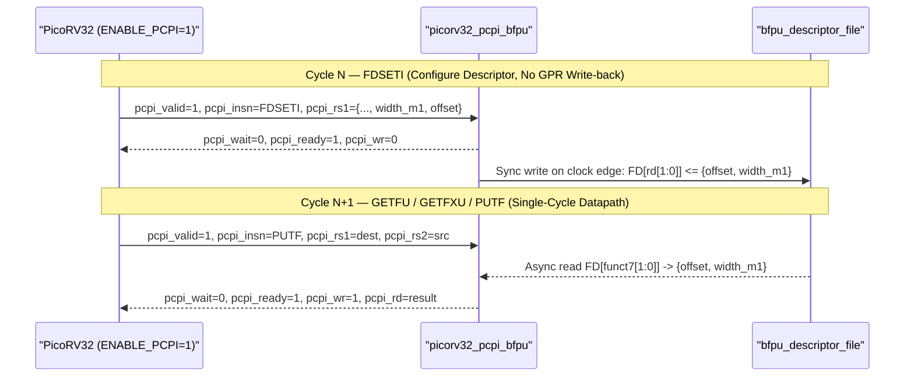

```text
Clock Cycle      |   T0 (Idle)   |   T1 (FDSETI)   |   T2 (PUTF/GETFU)  |   T3 (Idle)
-----------------+---------------+-----------------+--------------------+--------------
clock            | ___/‾‾‾\___   | ___/‾‾‾\___     | ___/‾‾‾\___        | ___/‾‾‾\___
pcpi_valid       | 0             | 1               | 1                  | 0
pcpi_insn        | X             | FDSETI          | PUTF / GETFU       | X
pcpi_wait        | 0             | 0               | 0                  | 0
pcpi_ready       | 0             | 1               | 1                  | 0
pcpi_wr          | 0             | 0 (suppressed)  | 1 (write to rd)    | 0
pcpi_rd          | X             | X               | Valid Result       | X
FD[sel]          | old           | old -> new @clk | new (async read)   | new
```

### Zero CPU Modification Rationale

Keeping `picorv32.v` untouched (`ENABLE_PCPI=1`, `ENABLE_MUL=0`, `ENABLE_DIV=0`, `ENABLE_IRQ=0`) yields three practical engineering advantages:
1. **Upstream Verification Integrity:** The RV32I base core remains 100% unmodified from Claire Wolf / YosysHQ's golden RTL, eliminating regression risk in base integer execution, CSR logic, or memory FSM states.
2. **Modular Isolation:** The BFPU peripheral can be tested completely independently by stimulating the PCPI pins directly—as demonstrated in `testbench/tb_picorv32_pcpi_bfpu.v`.
3. **Clean Synthesis Attribution:** FPGA LUT, FF, and critical-path comparisons between the baseline RV32I system and the BFPU-accelerated system directly isolate the exact hardware cost of the accelerator.

> [!NOTE]
> **Known Integration Status (`top.v`):** At present, `rtl/top.v` has its PCPI output wires hardwired to zero. The BFPU peripheral is fully verified standalone via `testbench/tb_picorv32_pcpi_bfpu.v` and in a separate system-level simulation used for the benchmark evaluations. Connecting the BFPU PCPI port directly inside `rtl/top.v` is a tracked open integration item.

---

## Custom BFPU Instruction Set

All four BFPU instructions share the RISC-V standard custom major opcode **`custom-0` (`7'b0001011`)** and are disambiguated by `funct3` (`insn[14:12]`).

### Instruction Summary Table

| Mnemonic | Major Opcode (`[6:0]`) | `funct3` (`[14:12]`) | Encoding Shape | Operands & Control Source | Architectural Operation | GPR Write-Back (`pcpi_wr`) | Latency |
| :--- | :--- | :--- | :--- | :--- | :--- | :--- | :--- |
| **`GETFU`** | `7'b0001011` | `3'b000` | I-type-shaped | `rs1`, `offset = insn[24:20]`, `width-1 = insn[30:26]` | `rd = (rs1 >> offset) & mask(width)` | Yes (`1`) | 1 cycle |
| **`GETFXU`** | `7'b0001011` | `3'b010` | R-type | `rs1`, `rs2` (`offset = rs2[4:0]`, `width-1 = rs2[9:5]`) | `rd = (rs1 >> offset) & mask(width)` | Yes (`1`) | 1 cycle |
| **`FDSETI`** | `7'b0001011` | `3'b100` | R-type-shaped | `rs1` (`offset = rs1[4:0]`, `width-1 = rs1[9:5]`), target `FD[rd[1:0]]` | `FD[rd[1:0]] <= {offset, width-1}` | No (`0`) | 1 cycle |
| **`PUTF`** | `7'b0001011` | `3'b110` | R-type | `rs1` (dest), `rs2` (src), `FD[funct7[1:0]]` | `rd = (rs1 & ~pmask) \| ((rs2 << offset) & pmask)` | Yes (`1`) | 1 cycle |

### The `width - 1` Encoding Rationale

Across all BFPU instructions and descriptor entries, field width is always encoded as **`width - 1`** (`width_m1`), spanning unsigned 5-bit values **`0` through `31`**, which correspond to actual bit-field widths of **`1` through `32` bits**.

- **Why not encode `width` directly?** Representing widths `1..32` directly in unsigned binary requires **6 bits** (`32 = 6'b100000`), while wasting the `0` encoding (since a 0-bit field has no hardware utility).
- **Packing Efficiency:** Encoding `width - 1` maps the useful range `[1, 32]` bijectively onto `[0, 31]`, requiring only **5 bits** (`[4:0]`). Combined with the 5-bit `offset` (`0..31`), a complete field descriptor `{offset[4:0], width_m1[4:0]}` occupies exactly **10 bits**—fitting comfortably inside both the 12-bit immediate window of `GETFU` and the low 10 bits of a general-purpose register for `GETFXU`/`FDSETI`.
- **Direct Mask-Generator Synergy:** Inside `bfpu_mask_generator.v`, `width_m1` feeds directly into `32'hFFFFFFFF >> (31 - width_m1)`, requiring zero extra adders or width-adjustment logic and avoiding any 33-bit intermediate when `width = 32`.

### Descriptor File (`FD0`–`FD3`) Organization

A standard RISC-V R-type instruction only provides two source register fields (`rs1`, `rs2`) and one destination (`rd`), leaving only `funct7` (7 bits) for metadata—insufficient to carry both a 5-bit `offset` and a 5-bit `width_m1` (10 bits total) directly inside `PUTF`. To preserve full read-modify-write semantics (`rs1` base word + `rs2` insertion value → `rd` result) within a 32-bit instruction word, the BFPU introduces a **4-entry descriptor register file (`FD0`–`FD3`)**:

| Descriptor Entry | Selector (`rd[1:0]` in `FDSETI` / `funct7[1:0]` in `PUTF`) | Stored Layout (`10 bits`) | Reset Value |
| :--- | :--- | :--- | :--- |
| **`FD0`** | `2'b00` | `{offset[4:0], width_m1[4:0]}` | `10'b00000_00000` (`offset=0, width=1`) |
| **`FD1`** | `2'b01` | `{offset[4:0], width_m1[4:0]}` | `10'b00000_00000` (`offset=0, width=1`) |
| **`FD2`** | `2'b10` | `{offset[4:0], width_m1[4:0]}` | `10'b00000_00000` (`offset=0, width=1`) |
| **`FD3`** | `2'b11` | `{offset[4:0], width_m1[4:0]}` | `10'b00000_00000` (`offset=0, width=1`) |

In practice, firmware executes `FDSETI` once during initialization to bind `FD0`–`FD3` to recurrent bit-field geometries, then executes single-cycle `PUTF` instructions in tight loops with zero setup overhead per iteration.

---

### 1. `GETFU` — Immediate Unsigned Bit-Field Extract

Extracts a contiguous bit-field from `rs1` using compile-time constant `offset` and `width - 1` embedded directly in the instruction word, zero-extending the result into `rd`.

- **Format:** I-type-shaped (`funct3 = 3'b000`)
- **Operation:** `rd = (rs1 >> offset) & mask(width)`

| Bits | `31` | `30:26` | `25` | `24:20` | `19:15` | `14:12` | `11:7` | `6:0` |
| :--- | :---: | :---: | :---: | :---: | :---: | :---: | :---: | :---: |
| **Field** | `-` | `width_m1[4:0]` | `-` | `offset[4:0]` | `rs1` | `3'b000` | `rd` | `7'b0001011` |
| **Width** | 1 | 5 | 1 | 5 | 5 | 3 | 5 | 7 |

- **Field Mapping:**
  - `offset` = `insn[24:20]` (`0..31`)
  - `width - 1` = `insn[30:26]` (`0..31` → actual width `1..32`)
- **Use Case:** Ideal when field boundaries are known statically at compile time—for example, extracting `RES[25:24]`, `DSCP[23:18]`, `TTL[15:8]`, or RGB channels `R[23:19]`, `G[15:10]`, `B[7:3]`.

---

### 2. `GETFXU` — Register-Controlled Unsigned Bit-Field Extract

Extracts a contiguous bit-field from `rs1` where both the bit `offset` and `width - 1` are supplied dynamically at runtime via general-purpose register `rs2`.

- **Format:** R-type (`funct3 = 3'b010`)
- **Operation:** `rd = (rs1 >> rs2[4:0]) & mask(rs2[9:5] + 1)`

| Bits | `31:25` | `24:20` | `19:15` | `14:12` | `11:7` | `6:0` |
| :--- | :---: | :---: | :---: | :---: | :---: | :---: |
| **Field** | `funct7` | `rs2` | `rs1` | `3'b010` | `rd` | `7'b0001011` |
| **Width** | 7 | 5 | 5 | 3 | 5 | 7 |

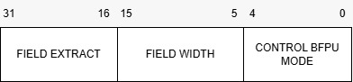

- **`rs2` Control Word Layout:**
  - `rs2[4:0]` = `offset` (`0..31`)
  - `rs2[9:5]` = `width - 1` (`0..31` → actual width `1..32`)
- **Use Case:** Enables dynamic bit-field parsing where field positions or widths are calculated at runtime, indexed from lookup tables, or passed as function arguments without generating self-modifying code.

---

### 3. `FDSETI` — Configure Field Descriptor Entry

Writes a 10-bit `{offset, width - 1}` descriptor into one of the four internal descriptor registers (`FD0`–`FD3`) using values carried in `rs1`, while suppressing general-purpose register write-back.

- **Format:** R-type-shaped (`funct3 = 3'b100`)
- **Operation:** `FD[rd[1:0]] = {rs1[4:0], rs1[9:5]}` (no GPR write-back: `pcpi_wr = 1'b0`)

| Bits | `31:25` | `24:20` | `19:15` | `14:12` | `11:7` | `6:0` |
| :--- | :---: | :---: | :---: | :---: | :---: | :---: |
| **Field** | `funct7` / `-` | `rs2` / `-` | `rs1` | `3'b100` | `rd` (`rd[1:0]` = FD index) | `7'b0001011` |
| **Width** | 7 | 5 | 5 | 3 | 5 | 7 |

- **Field Mapping:**
  - `offset` = `rs1[4:0]`
  - `width - 1` = `rs1[9:5]`
  - Descriptor target = `rd[1:0]` (`2'b00` → `FD0`, `2'b01` → `FD1`, `2'b10` → `FD2`, `2'b11` → `FD3`)
- **Write-Back Suppression:** Because `is_fdseti` deasserts `pcpi_wr`, the `rd` field serves purely as a 2-bit descriptor selector without corrupting CPU general-purpose registers.

---

### 4. `PUTF` — Descriptor-Guided Bit-Field Insert

Inserts the lower `width` bits of `rs2` into `rs1` at bit position `offset` using the geometry stored in descriptor `FD[funct7[1:0]]`, preserving all bits of `rs1` outside `[offset + width - 1 : offset]`.

- **Format:** R-type (`funct3 = 3'b110`)
- **Operation:** `rd = (rs1 & ~pmask) | ((rs2 << offset) & pmask)`

| Bits | `31:25` | `24:20` | `19:15` | `14:12` | `11:7` | `6:0` |
| :--- | :---: | :---: | :---: | :---: | :---: | :---: |
| **Field** | `funct7` (`funct7[1:0]` = FD index) | `rs2` (src value) | `rs1` (dest word) | `3'b110` | `rd` | `7'b0001011` |
| **Width** | 7 | 5 | 5 | 3 | 5 | 7 |

- **Field Mapping:**
  - `funct7[1:0]` (`insn[26:25]`) selects descriptor `FD0`–`FD3`, providing `{fd_offset, fd_width_m1}`.
  - `rs1` supplies the base destination word whose non-target bits are preserved.
  - `rs2` supplies the source data; any bits beyond the descriptor width are automatically masked away by `pmask` (`positioned_mask`), safely handling oversized inputs.

---

## Hardware Architecture and Module Descriptions

The complete system consists of nine Verilog RTL modules organized cleanly across the SoC wrapper, the unmodified PicoRV32 CPU, the BFPU PCPI peripheral and its five internal datapath/control submodules, and the 16 KB on-chip RAM.

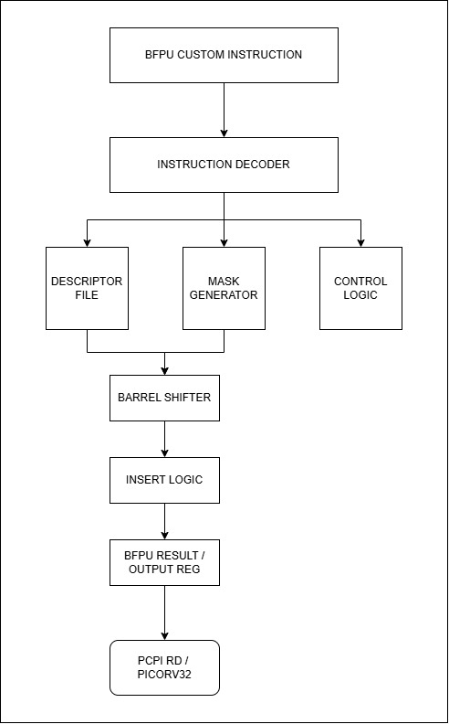

### RTL Module Inventory

| # | Module File | Module Scope | Logic Type | Functional Description |
| :---: | :--- | :--- | :--- | :--- |
| 1 | `rtl/top.v` | SoC Top-Level | Structural / Sequential | Integrates PicoRV32, BFPU, and 16 KB `simple_ram`; drives `led = mem_addr[15:0]`. *(Note: PCPI outputs in `top.v` are currently hardwired to zero as a tracked open item.)* |
| 2 | `rtl/picorv32.v` | Base CPU Core | Sequential / FSM | Unmodified open-source PicoRV32 RV32I processor configured with `ENABLE_PCPI=1` and `ENABLE_MUL=0`, `ENABLE_DIV=0`, `ENABLE_IRQ=0`. |
| 3 | `rtl/picorv32_pcpi_bfpu.v` | BFPU PCPI Wrapper | Mixed (Comb Datapath + Sync DF) | Top-level PCPI peripheral integrating the 5 BFPU submodules via inline multiplexer select logic; ties `pcpi_wait=0`, drives `pcpi_ready`, `pcpi_wr`, and `pcpi_rd`. |
| 4 | `rtl/bfpu_decoder.v` | Instruction Decoder | Pure Combinational | Decodes `pcpi_insn` against major opcode `7'b0001011`; extracts `funct3`, `funct7`, `rd`, and `GETFU` immediates (`offset`, `width_m1`), generating `is_bfpu_op` and instruction-type flags. |
| 5 | `rtl/bfpu_descriptor_file.v` | Descriptor Storage | Sync Write / Async Read | 4×10-bit register file (`FD0`–`FD3`) storing `{offset[4:0], width_m1[4:0]}`. Resets all entries to `0`; writes synchronously on `FDSETI`; reads asynchronously for single-cycle `PUTF`. |
| 6 | `rtl/bfpu_barrel_shifter.v` | Shared Shifter | Pure Combinational | Single shared bidirectional 32-bit barrel shifter controlled by `shift_left`: shifts left (`shift_left=1`) for `PUTF` and shifts right (`shift_left=0`) for `GETFU`/`GETFXU`. |
| 7 | `rtl/bfpu_mask_generator.v` | Mask Unit | Pure Combinational | Generates `raw_mask = 32'hFFFFFFFF >> (31 - width_m1)` and `positioned_mask = raw_mask << offset`; structured to avoid any 33-bit intermediate overflow when `width=32`. |
| 8 | `rtl/bfpu_insert_logic.v` | Blend / Insert Unit | Pure Combinational | Computes `result = (destination & ~positioned_mask) | (shifted_value & positioned_mask)` to merge shifted source bits into the destination word cleanly. |
| 9 | `rtl/simple_ram.v` | On-Chip Memory | Comb Read / Sync Write | 16 KB (`4096 × 32-bit`) memory providing single-cycle combinational reads, synchronous byte-lane writes, and zero-wait handshake (`mem_ready = mem_valid`). |

### Key Microarchitectural Design Details

- **Overflow-Free Mask Generation (`bfpu_mask_generator.v`):**
  A textbook software mask formula such as `(1 << width) - 1` fails in 32-bit hardware when `width = 32`, because `1 << 32` requires a 33-bit intermediate before subtraction. Instead, `bfpu_mask_generator.v` computes:
  ```verilog
  assign raw_mask        = 32'hFFFFFFFF >> (31 - width_m1);
  assign positioned_mask = raw_mask << offset;
  ```
  - When `width = 1` (`width_m1 = 0`): `32'hFFFFFFFF >> 31 = 32'h00000001`.
  - When `width = 32` (`width_m1 = 31`): `32'hFFFFFFFF >> 0 = 32'hFFFFFFFF`.
  - When `width = 8` (`width_m1 = 7`), `offset = 24`: `raw_mask = 32'h000000FF`, `positioned_mask = 32'hFF000000`.
  Every case evaluates cleanly inside 32-bit unsigned arithmetic with predictable combinational delay.

- **Asynchronous Descriptor Read + Synchronous Write (`bfpu_descriptor_file.v`):**
  For `FDSETI`, the write happens synchronously on the clock edge, locking `{offset, width_m1}` cleanly without combinational glitches. For `PUTF`, the read port indexed by `funct7[1:0]` is **asynchronous**, allowing `fd_offset` and the stored `width_m1` to propagate immediately through `bfpu_barrel_shifter`, `bfpu_mask_generator`, and `bfpu_insert_logic` within the same clock cycle.

- **Single-Cycle Memory Model (`simple_ram.v`):**
  With `mem_ready = mem_valid`, combinational reads, and synchronous byte-lane writes across `4096 × 32-bit` words (16 KB), `simple_ram.v` avoids multi-cycle memory wait states in system-level simulation.

---

## Instruction Execution Flow

Inside `picorv32_pcpi_bfpu.v`, inline combinational multiplexers steer operands and control signals through the shared datapath depending on the decoded instruction.

### Inline Multiplexer Control Matrix

| Datapath / Control Path | `GETFU` (`3'b000`) | `GETFXU` (`3'b010`) | `FDSETI` (`3'b100`) | `PUTF` (`3'b110`) |
| :--- | :--- | :--- | :--- | :--- |
| **Shifter Data Input** | `pcpi_rs1` | `pcpi_rs1` | Don't care | `pcpi_rs2` |
| **Shifter Direction (`shift_left`)** | `1'b0` (Right shift) | `1'b0` (Right shift) | Don't care | `1'b1` (Left shift) |
| **Shift `offset` Source** | `insn[24:20]` | `pcpi_rs2[4:0]` | `pcpi_rs1[4:0]` (written to FD) | `fd_offset` (from `FD[funct7[1:0]]`) |
| **`width_m1` Source** | `insn[30:26]` | `pcpi_rs2[9:5]` | `pcpi_rs1[9:5]` (written to FD) | Stored `width_m1` (from `FD[funct7[1:0]]`) |
| **Mask Applied** | `raw_mask` | `raw_mask` | None | `positioned_mask` |
| **`pcpi_rd` Result Mux** | `shifted_value & raw_mask` | `shifted_value & raw_mask` | `32'd0` / unused | `result` (`bfpu_insert_logic`) |
| **Descriptor Write Enable** | `1'b0` | `1'b0` | `pcpi_valid` (`FD[rd[1:0]]`) | `1'b0` |
| **`pcpi_ready`** | `pcpi_valid` | `pcpi_valid` | `pcpi_valid` | `pcpi_valid` |
| **`pcpi_wr`** | `pcpi_valid` (`1`) | `pcpi_valid` (`1`) | `1'b0` (No GPR write-back) | `pcpi_valid` (`1`) |
| **`pcpi_wait`** | `1'b0` | `1'b0` | `1'b0` | `1'b0` |

### Step-by-Step Execution Traces

1. **`GETFU` Execution (`rd = (rs1 >> insn[24:20]) & mask(insn[30:26] + 1)`):**
   - **Step 1 (Decode):** `bfpu_decoder` recognises `opcode == 7'b0001011` and `funct3 == 3'b000`, extracting `offset = insn[24:20]` and `width_m1 = insn[30:26]`.
   - **Step 2 (Shift & Mask in Parallel):** `bfpu_barrel_shifter` receives `pcpi_rs1` with `shift_left = 0` and shifts right logically by `offset`. Simultaneously, `bfpu_mask_generator` computes `raw_mask = 32'hFFFFFFFF >> (31 - width_m1)`.
   - **Step 3 (Result Select & Retire):** The output mux selects `shifted_value & raw_mask` onto `pcpi_rd`, asserting `pcpi_ready = 1` and `pcpi_wr = 1` with `pcpi_wait = 0` so PicoRV32 latches `rd` on the next clock edge.

2. **`GETFXU` Execution (`rd = (rs1 >> rs2[4:0]) & mask(rs2[9:5] + 1)`):**
   - **Step 1 (Decode):** `bfpu_decoder` recognises `funct3 == 3'b010` and sets the parameter select mux to read `offset = pcpi_rs2[4:0]` and `width_m1 = pcpi_rs2[9:5]`.
   - **Step 2 (Shift & Mask in Parallel):** `bfpu_barrel_shifter` shifts `pcpi_rs1` right by `pcpi_rs2[4:0]` (`shift_left = 0`) while `bfpu_mask_generator` forms `raw_mask` from `pcpi_rs2[9:5]`.
   - **Step 3 (Result Select & Retire):** `pcpi_rd` receives `shifted_value & raw_mask`, and `pcpi_ready = 1`, `pcpi_wr = 1`, `pcpi_wait = 0` complete the transaction in one cycle.

3. **`FDSETI` Execution (`FD[rd[1:0]] <= {rs1[4:0], rs1[9:5]}`):**
   - **Step 1 (Decode):** `bfpu_decoder` detects `funct3 == 3'b100`, asserting `is_fdseti = 1`.
   - **Step 2 (Write-Back Suppression):** The wrapper sets `pcpi_wr = 0` (preventing PicoRV32 from writing to architectural register `rd`) while driving `pcpi_ready = 1` and `pcpi_wait = 0`.
   - **Step 3 (Descriptor Capture):** `bfpu_descriptor_file` latches `{pcpi_rs1[4:0], pcpi_rs1[9:5]}` synchronously into entry `FD[rd[1:0]]` on the clock edge.

4. **`PUTF` Execution (`rd = (rs1 & ~pmask) | ((rs2 << offset) & pmask)`):**
   - **Step 1 (Decode & Async Descriptor Lookup):** `bfpu_decoder` identifies `funct3 == 3'b110` and supplies `funct7[1:0]` to `bfpu_descriptor_file`, which asynchronously outputs `fd_offset` and the stored `width_m1`.
   - **Step 2 (Shift Left & Positioned Mask in Parallel):** `bfpu_barrel_shifter` receives `pcpi_rs2` with `shift_left = 1` and shifts left by `fd_offset` (`shifted_value = rs2 << fd_offset`). Simultaneously, `bfpu_mask_generator` produces `raw_mask` from the descriptor's `width_m1` and shifts it left by `fd_offset` to produce `positioned_mask`.
   - **Step 3 (Blend & Retire):** `bfpu_insert_logic` computes `result = (destination & ~positioned_mask) | (shifted_value & positioned_mask)` with `destination = pcpi_rs1`. The wrapper routes `result` to `pcpi_rd`, asserting `pcpi_ready = 1` and `pcpi_wr = 1` with `pcpi_wait = 0`.

### The `PUTF` Reordered-Arithmetic Microarchitectural Optimisation

A conventional software or hardware bit-field insert typically masks the incoming value *before* shifting it into position:

$$\text{Naive Insert} = (\text{rs1} \land \neg \text{positioned\_mask}) \;\lor\; \big((\text{rs2} \land \text{raw\_mask}) \ll \text{offset}\big)$$

Executing `mask-then-shift` in hardware would require either a dedicated masking stage ahead of the barrel shifter or a second shifter/mask path exclusively for `PUTF`. Instead, the BFPU applies the distributive identity of bit-shifting over bitwise AND:

$$(\text{rs2} \land \text{raw\_mask}) \ll \text{offset} \;\equiv\; (\text{rs2} \ll \text{offset}) \land (\text{raw\_mask} \ll \text{offset}) \;\equiv\; (\text{rs2} \ll \text{offset}) \land \text{positioned\_mask}$$

#### Worked Bit-Level Equivalence Example

Suppose descriptor `FD0` holds `offset = 24`, `width = 4` (`width_m1 = 3`), destination `rs1 = 32'h0A00_1234`, and an **oversized** source `rs2 = 32'hFFFF_FFFC` (intended 4-bit payload = `4'hC`):

1. `raw_mask` = `32'hFFFFFFFF >> (31 - 3)` = `32'h0000_000F`
2. `positioned_mask` = `32'h0000_000F << 24` = `32'h0F00_0000`
3. **Shift first (`bfpu_barrel_shifter`, `shift_left = 1`):**
   `shifted_value` = `32'hFFFF_FFFC << 24` = `32'hFC00_0000`
4. **Blend with `positioned_mask` (`bfpu_insert_logic`):**
   - `rs1 & ~positioned_mask` = `32'h0A00_1234 & 32'hF0FF_FFFF` = `32'h0000_1234`
   - `shifted_value & positioned_mask` = `32'hFC00_0000 & 32'h0F00_0000` = `32'h0C00_0000`
   - `result` = `32'h0000_1234 | 32'h0C00_0000` = `32'h0C00_1234`

By shifting `rs2` left first and masking afterwards with `positioned_mask`, the upper oversized bits of `rs2` are stripped identically to pre-masking, **while allowing one shared barrel shifter and one shared mask generator to handle `GETFU`, `GETFXU`, and `PUTF` in a single cycle without duplicating any arithmetic hardware**.

---

## FPGA Implementation

Post-implementation synthesis and place-and-route were performed in **AMD/Xilinx Vivado** comparing the baseline RV32I PicoRV32 system against the BFPU-augmented system at a **100 MHz** clock target.

### Post-Implementation Resource & Timing Summary

| Metric | RV32I Baseline | BFPU System | Delta / Change |
| :--- | :---: | :---: | :---: |
| **LUT** | 3,262 | 3,557 | **+295 (+9.04%)** |
| **FF (Flip-Flops)** | 675 | 722 | **+47 (+6.96%)** |
| **LUTRAM** | 2,092 | 2,092 | **0 (0%)** |
| **IO** | 18 | 18 | **0 (0%)** |
| **WNS (Worst Negative Slack @ 100 MHz)** | +0.705 ns | +0.402 ns | **−0.303 ns** |
| **Fmax (Estimated Maximum Frequency)** | ≈ 107.6 MHz | ≈ 104.2 MHz | **−3.2%** |
| **Timing Closure @ 100 MHz** | **PASS** | **PASS** | **Met** |

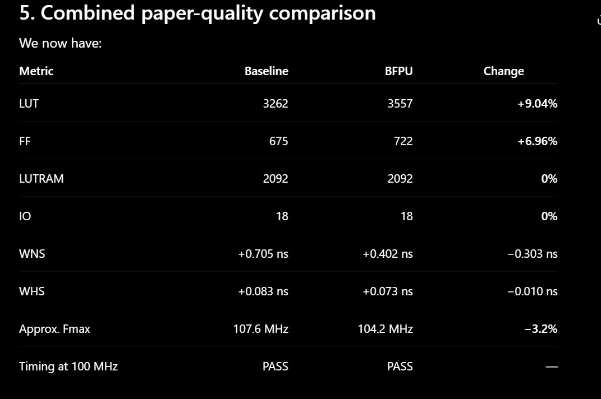

### Area vs. Timing Trade-Off Discussion

- **Sub-10% Logic Overhead:** The entire BFPU co-processor—decoder, 4×10-bit descriptor file, bidirectional 32-bit barrel shifter, mask generator, insert logic, and PCPI muxing—adds only **295 LUTs (+9.04%)** and **47 FFs (+6.96%)**. The `PUTF` reordered-arithmetic sharing strategy prevents instantiating a second barrel shifter, keeping combinational LUT growth tightly bounded.
- **Zero Memory & Pin Penalty:** Both **LUTRAM (2,092)** and **IO (18)** remain completely unchanged (`0%` delta), confirming the accelerator introduces zero RAM-block inflation and zero external I/O pin overhead.
- **Flip-Flop Attribution:** Of the +47 additional flip-flops, 40 FFs correspond directly to the 4×10-bit `FD0`–`FD3` entries inside `bfpu_descriptor_file.v`, with the remaining 7 FFs stemming from synthesis control/register balancing.
- **Single-Cycle Critical Path Impact:** Because `pcpi_wait` is tied to `1'b0`, the combinational path from PicoRV32's `pcpi_rs1`/`pcpi_rs2`/`pcpi_insn` outputs through the asynchronous descriptor lookup, barrel shifter, mask generator, and insert unit back into `pcpi_rd` must close within a single 10 ns clock period. This reduces Worst Negative Slack from **+0.705 ns** (`Fmax ≈ 107.6 MHz`) to **+0.402 ns** (`Fmax ≈ 104.2 MHz`, a modest **−3.2%** shift) while still clearing **100 MHz** post-implementation timing cleanly with positive margin.

---

## Simulation and Verification

The BFPU peripheral is verified at two levels: a standalone, self-checking unit testbench driving the PCPI interface directly, and system-level simulation runs capturing full benchmark waveforms.

### Standalone Self-Checking Testbench (`testbench/tb_picorv32_pcpi_bfpu.v`)

- **Architecture:** Instantiates `picorv32_pcpi_bfpu` directly without requiring `picorv32.v`, stimulating `pcpi_valid`, `pcpi_insn`, `pcpi_rs1`, and `pcpi_rs2` at a **100 MHz** simulation clock (`10 ns` period) and automatically checking `pcpi_rd`, `pcpi_ready`, `pcpi_wr`, and `pcpi_wait` against expected golden values.
- **Directed Test Coverage:**
  - **`GETFU` Corner Cases:**
    - Low-byte extraction (`offset = 0`, `width = 8`)
    - Upper-byte extraction (`offset = 24`, `width = 8`)
    - Full-word extraction (`width = 32`, verifying zero overflow in `raw_mask`)
    - Single-bit extraction (`width = 1`, minimum field width)
    - Mid-value `width_m1` regression
  - **`GETFXU` Dynamic Extraction:**
    - Runtime control-word extraction (`offset = 4`, `width = 4` supplied via `rs2`)
  - **`FDSETI` → `PUTF` Sequence:**
    - Configuring descriptor `FD0` via `FDSETI` (verifying `pcpi_wr == 0`)
    - Inserting a field into an all-zero destination (`rs1 = 32'h0000_0000`)
    - Clearing an existing field inside an all-ones destination (`rs1 = 32'hFFFF_FFFF`, `rs2 = 32'h0000_0000`)
    - Oversized source value handling (confirming bits wider than descriptor width do not bleed into adjacent destination bits)
  - **Descriptor Isolation:**
    - Verifying `FD0` and `FD3` independence (writing/modifying one entry preserves the contents of the other)
- **Randomised Regression:**
  - Executes **200 randomised test iterations** across all four instructions (`GETFU`, `GETFXU`, `FDSETI`, `PUTF`) against a behavioral golden reference model to expose corner-case interactions across random offsets, widths, descriptors, and operands.

### Running the Unit Testbench (Icarus Verilog)

```bash
iverilog -o bfpu_tb.out \
  testbench/tb_picorv32_pcpi_bfpu.v \
  rtl/picorv32_pcpi_bfpu.v \
  rtl/bfpu_decoder.v \
  rtl/bfpu_descriptor_file.v \
  rtl/bfpu_barrel_shifter.v \
  rtl/bfpu_mask_generator.v \
  rtl/bfpu_insert_logic.v && vvp bfpu_tb.out
```

### Simulation Waveforms

The figures below illustrate system-level simulation waveforms captured during benchmark verification (separate from the standalone `tb_picorv32_pcpi_bfpu.v` testbench while `top.v` PCPI wiring remains an open integration item):

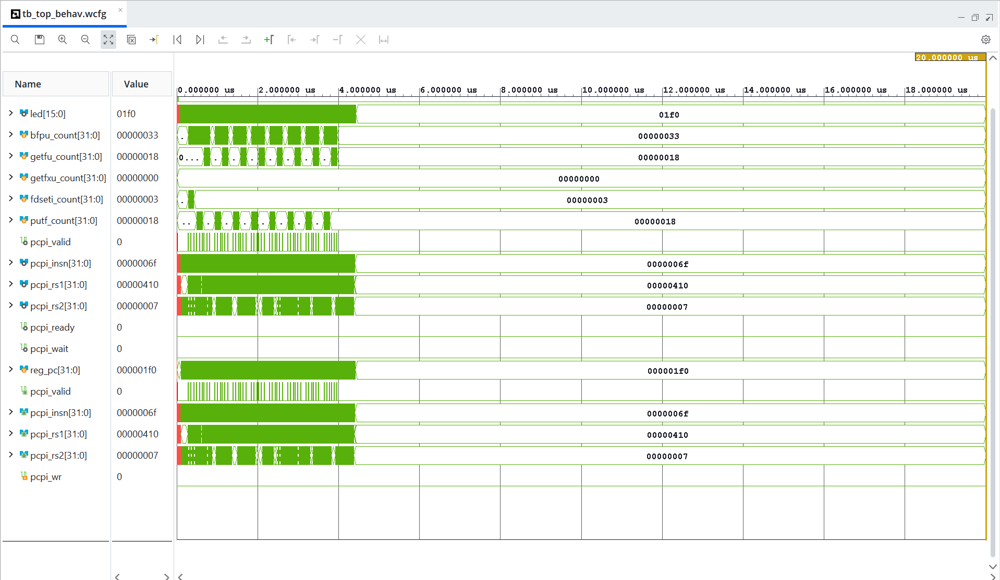

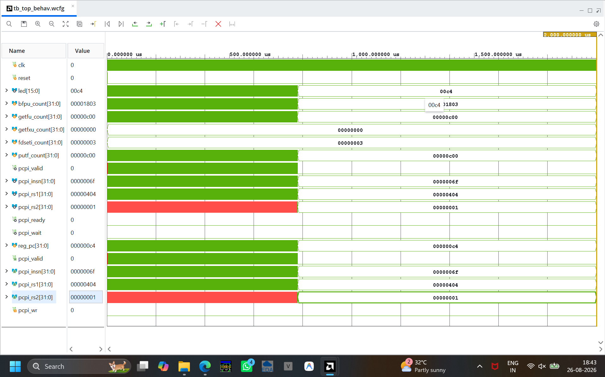

---

## Benchmark Methodology and Results

To quantify real-world architectural impact beyond synthetic unit tests, the BFPU-enabled system was evaluated against the baseline RV32I core across **three distinct application domains**: embedded peripheral configuration, networking packet header manipulation, and graphics pixel repacking. Each workload compares handwritten RV32I baseline assembly against BFPU-accelerated assembly executing the exact same algorithmic transformations, measuring code size, cycle counts, CPI, speedup, and energy consumption (normalised to RV32I).

### 1. ADC Register Configuration (Embedded / IoT)

- **Workload Description:** Performs **8 sequential configurations** of 3 memory-mapped ADC control registers (`CR1`, `CR2`, `SQR3`), updating packed configuration fields:
  - `RES[25:24]` (width = 2 bits)
  - `CH[4:0]` (width = 5 bits)
  - `TRIG[27:24]` (width = 4 bits)
- **Implementation Comparison:**
  - **RV32I Baseline:** **229 assembly lines**; requires precomputed clear-masks and **3–5 instructions per field operation** (mask load/construction, bitwise `AND` clear, source mask/shift, bitwise `OR`).
  - **BFPU Accelerated:** **149 assembly lines** (down from 229 lines); issues `FDSETI` once up front for descriptor setup, then executes single `PUTF`/`GETFU` instructions per field operation.
- **Measured Gains:**
  - **Cycles:** `~657` (RV32I) → `~328` (BFPU) — **1.99× speedup**, **49.7% fewer cycles**.
  - **Detailed Instruction & CPI Profile:** RV32I (`502` cycles / `124` instructions / **CPI `4.048`**) vs. BFPU (`328` cycles / `93` instructions / **CPI `3.527`**).
  - **Energy:** `0.632 μJ` (RV32I) → `0.410 μJ` (BFPU) — **−35.1% energy reduction**.

### 2. Packet Header Field Processing (Networking)

- **Workload Description:** Processes **4 IPv4 packet headers**, extracting and updating three protocol header fields per packet:
  - `DSCP[23:18]` (width = 6 bits)
  - `TTL[15:8]` (width = 8 bits)
  - `Protocol[7:0]` (width = 8 bits)
- **Self-Checking Verification:** Computes and verifies the expected packet checksum, writing a deterministic `PASS`/`FAIL` status flag to `RAM[0x404]`.
- **Implementation Comparison:**
  - **RV32I Baseline:** **149 assembly lines**.
  - **BFPU Accelerated:** **118 assembly lines**; configures **3 `FDSETI` descriptors** at initialization, then executes `GETFU` and `PUTF` directly per packet.
- **Measured Gains:**
  - **Cycles:** `502` (RV32I) → `328` (BFPU) — **1.53× speedup**, **34.5% fewer cycles**.
  - **Energy:** `0.378 μJ` (RV32I) → `0.323 μJ` (BFPU) — **−14.4% energy reduction**.

### 3. RGB888 → RGB565 Pixel Conversion (Graphics / Display)

- **Workload Description:** Converts **1,024 packed 24-bit RGB888 pixels** into 16-bit RGB565 format inside a tight conversion loop:
  - Extracts `R[23:19]` (width = 5 bits), `G[15:10]` (width = 6 bits), and `B[7:3]` (width = 5 bits) and packs the truncated channels into 16-bit RGB565.
- **Implementation Comparison:**
  - **BFPU Accelerated:** Executes **3 `GETFU` extractions + 3 `PUTF` insertions per pixel**, eliminating per-channel shift-and-mask sequences while loop control overhead remains shared with the baseline.
- **Measured Gains:**
  - **Speedup & Cycles:** **1.34× speedup**, **25.5% fewer cycles**.
  - **Energy:** `108 μJ` (RV32I) → `73.2 μJ` (BFPU) — **−32.0% energy reduction**.

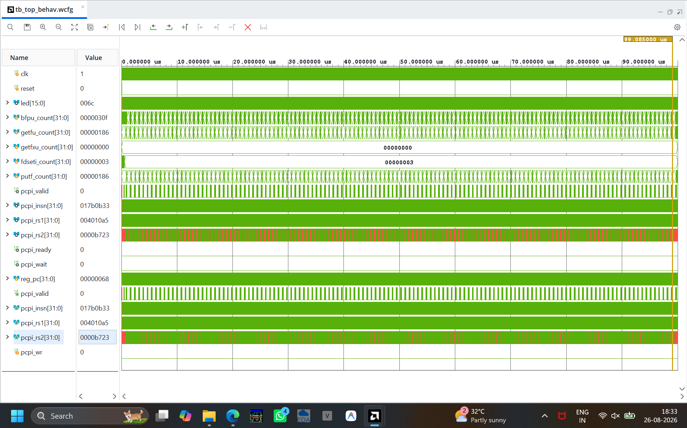

### Evaluation Visualisations

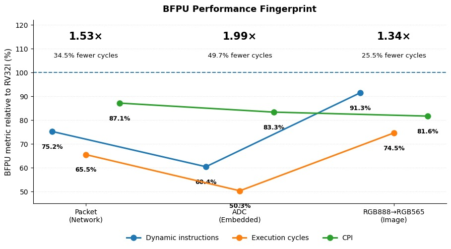

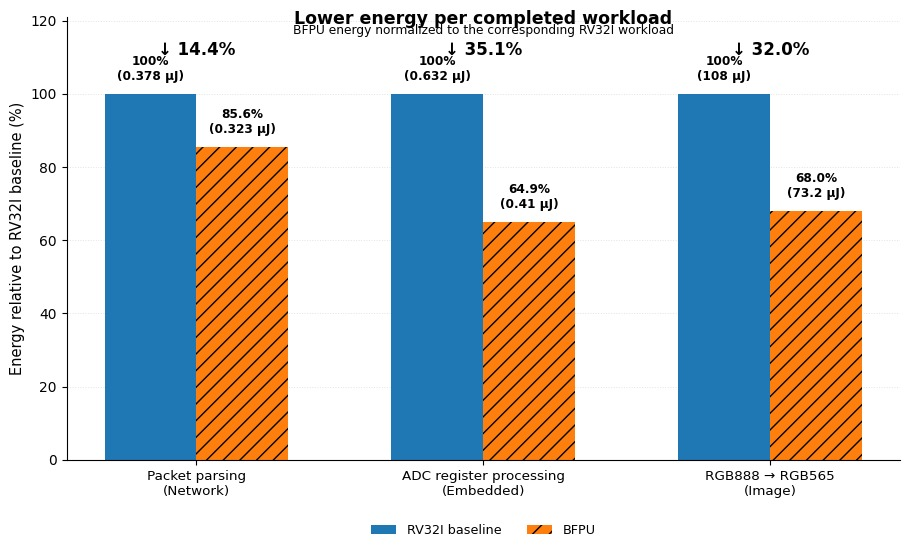

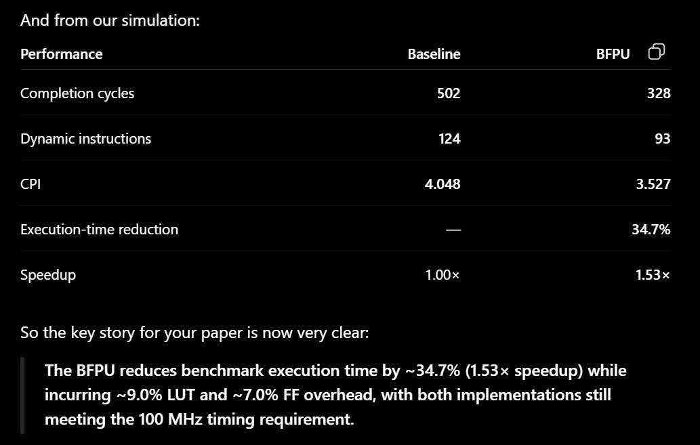

### Final Benchmark Summary Tables

#### Cycle Count & Speedup Summary

| Benchmark Domain | RV32I Assembly Lines | BFPU Assembly Lines | RV32I Cycles | BFPU Cycles | Speedup | Cycle Reduction |
| :--- | :---: | :---: | :---: | :---: | :---: | :---: |
| **ADC Register Config** (Embedded / IoT) | 229 | 149 | ~657 | ~328 | **1.99×** | **49.7%** |
| **Packet Header Processing** (Networking) | 149 | 118 | 502 | 328 | **1.53×** | **34.5%** |
| **RGB888 → RGB565 Conversion** (Graphics) | — | — | (baseline) | (BFPU) | **1.34×** | **25.5%** |

*ADC detailed instruction/CPI breakdown: RV32I `502` cycles / `124` instructions / CPI `4.048`; BFPU `328` cycles / `93` instructions / CPI `3.527`.*

#### Energy Consumption Summary (Normalised to RV32I)

| Benchmark Workload | RV32I Energy | BFPU Energy | Energy Reduction |
| :--- | :---: | :---: | :---: |
| **Packet Parsing** | 0.378 μJ | 0.323 μJ | **−14.4%** |
| **ADC Register Config** | 0.632 μJ | 0.410 μJ | **−35.1%** |
| **RGB888 → RGB565** | 108 μJ | 73.2 μJ | **−32.0%** |

---

## Repository Structure

```text
RISC-V-Bit-Field-Processing-Accelerator-for-Efficient-Packed-Data-Computing/
├── README.md                                   # Project technical documentation
├── rtl/
│   ├── top.v                                   # SoC top-level (PicoRV32 + BFPU + 16 KB RAM; PCPI wiring open item)
│   ├── picorv32.v                              # Unmodified PicoRV32 RV32I core (ENABLE_PCPI=1, MUL/DIV/IRQ=0)
│   ├── picorv32_pcpi_bfpu.v                    # BFPU PCPI wrapper with inline muxing & pcpi_wait=0
│   ├── bfpu_decoder.v                          # Pure combinational custom-0 decoder
│   ├── bfpu_descriptor_file.v                  # 4x10-bit descriptor file (sync write, async read)
│   ├── bfpu_barrel_shifter.v                   # Shared 32-bit bidirectional barrel shifter
│   ├── bfpu_mask_generator.v                   # Combinational raw_mask & positioned_mask generator
│   ├── bfpu_insert_logic.v                     # Bitwise mask-and-merge insert logic
│   └── simple_ram.v                            # 16 KB (4096x32-bit) single-cycle RAM
├── testbench/
│   └── tb_picorv32_pcpi_bfpu.v                 # Self-checking 100 MHz PCPI unit testbench (directed + 200 random)
├── docs/
│   └── architecture/
│       ├── system_block_diagram.jpeg           # Top-level PicoRV32 + BFPU + RAM architecture
│       ├── bfpu_internal_pipeline.jpeg         # Internal BFPU datapath and shared units diagram
│       └── getfxu_control_word_format.jpeg     # GETFXU rs2 control-word bit layout
└── images/
    ├── evaluation/
    │   ├── performance_fingerprint.jpeg        # Multi-benchmark speedup and cycle reduction profile
    │   ├── energy_efficiency.jpeg              # Normalised energy consumption comparison
    │   ├── fpga_resource_comparison.jpeg       # Vivado post-implementation LUT/FF/LUTRAM/WNS chart
    │   └── benchmark_performance_table.jpeg    # Consolidated benchmark performance summary chart
    └── simulation/
        ├── waveform_adcbench_counts.png        # ADC benchmark simulation waveform (cycle/instruction counts)
        ├── waveform_adcbench_final.png         # ADC benchmark simulation waveform (final state)
        └── waveform_rgbbench_fullrun.png       # RGB888 -> RGB565 conversion full-run simulation waveform
```

---

## How to Run

### 1. Standalone Unit Simulation (Icarus Verilog)

Ensure **Icarus Verilog** (`iverilog` and `vvp`) is installed and available in your `PATH`. From the repository root, compile and execute the self-checking BFPU testbench:

```bash
iverilog -o bfpu_tb.out testbench/tb_picorv32_pcpi_bfpu.v rtl/picorv32_pcpi_bfpu.v rtl/bfpu_decoder.v rtl/bfpu_descriptor_file.v rtl/bfpu_barrel_shifter.v rtl/bfpu_mask_generator.v rtl/bfpu_insert_logic.v && vvp bfpu_tb.out
```

This runs all directed corner-case assertions (`GETFU`, `GETFXU`, `FDSETI`→`PUTF`, `FD0`/`FD3` independence) followed by the 200-iteration randomised regression at 100 MHz.

### 2. FPGA Synthesis, Implementation, and Behavioural Simulation (AMD/Xilinx Vivado)

1. Create a new RTL project in **AMD/Xilinx Vivado** and add all Verilog sources from `rtl/` (`picorv32.v`, `picorv32_pcpi_bfpu.v`, `bfpu_decoder.v`, `bfpu_descriptor_file.v`, `bfpu_barrel_shifter.v`, `bfpu_mask_generator.v`, `bfpu_insert_logic.v`, `simple_ram.v`, and `top.v`).
   *(Note: If running full-SoC implementation with the BFPU active through `top.v`, first wire the PCPI signals inside `rtl/top.v` in place of the currently hardwired-zero PCPI outputs.)*
2. For **Behavioural Simulation**, add `testbench/tb_picorv32_pcpi_bfpu.v` as a simulation source, set it as the simulation top module, and launch **Run Simulation → Run Behavioral Simulation**.
3. For **Synthesis and Post-Implementation Timing/Utilization**, constrain the system clock to **100 MHz** (`10.0 ns` period), run **Synthesis** followed by **Implementation**, and inspect the post-implementation **Utilization** and **Timing Summary** reports (`WNS`, `LUT`, `FF`, `LUTRAM`, `IO`).

---

## Acknowledgements

- **PicoRV32:** This project builds directly upon the open-source **PicoRV32** size-optimized RISC-V RV32I CPU created by **Claire Wolf / YosysHQ**, used completely **unmodified** under the **ISC licence**. Its clean native **PCPI (Pico Co-Processor Interface)** makes cycle-accurate custom ISA extensions straightforward to design, isolate, and benchmark.
